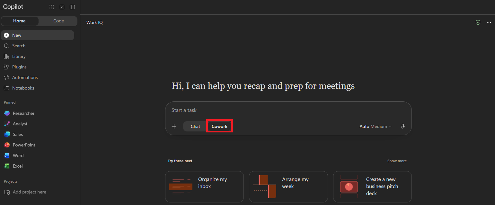
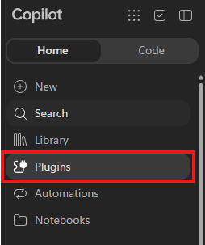
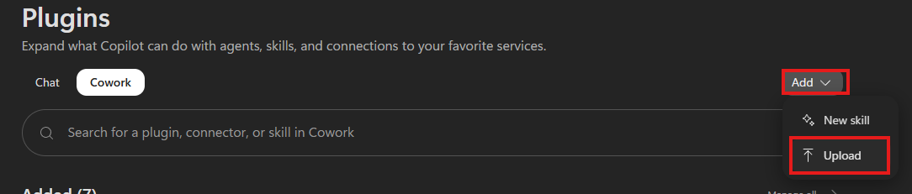
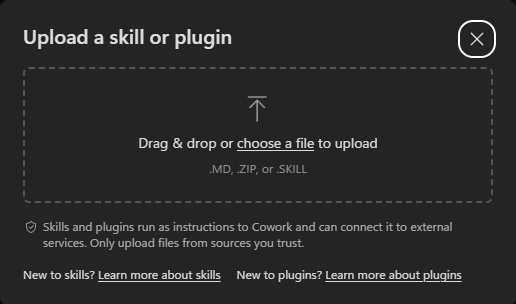

<script setup>
import { onMounted, onUnmounted, watch } from 'vue'
import { useRoute, withBase } from 'vitepress'

const route = useRoute()

function expandStepForHash(hash) {
  const step = document.getElementById(hash.slice(1))?.closest('details.workshop-step')
  if (step) step.open = true
}

function handleStepLink(event) {
  if (!(event.target instanceof Element) || event.button !== 0 ||
      event.ctrlKey || event.metaKey || event.shiftKey || event.altKey) return

  const link = event.target.closest('a[href^="#"]')
  if (link) expandStepForHash(link.getAttribute('href'))
}

onMounted(() => {
  expandStepForHash(route.hash)
  document.addEventListener('click', handleStepLink)
})

onUnmounted(() => document.removeEventListener('click', handleStepLink))
watch(() => route.hash, expandStepForHash)
</script>

<style scoped>
.workshop-meta,
.step-meta {
  display: flex;
  align-items: center;
  gap: 8px;
}

.workshop-meta {
  flex-wrap: wrap;
  margin: 20px 0 28px;
}

.workshop-meta span,
.step-time,
.step-optional {
  padding: 3px 10px;
  border: 1px solid var(--vp-c-divider);
  border-radius: 999px;
  background: var(--vp-c-bg-soft);
  color: var(--vp-c-text-2);
  font-size: 12px;
  font-weight: 500;
  line-height: 1.5;
  white-space: nowrap;
}

.approach-cards {
  display: grid;
  grid-template-columns: minmax(0, 1fr);
  gap: 12px;
  margin: 20px 0;
}

.approach-card h3,
.approach-card p {
  margin: 0;
}

.approach-card h3 {
  font-size: 16px;
  line-height: 1.5;
}

.approach-card--coach {
  border-left: 3px solid var(--vp-c-brand-1);
  background: var(--vp-c-brand-soft);
}

.approach-tagline {
  color: var(--vp-c-text-1);
  font-size: 14px;
  font-weight: 500;
  line-height: 1.5;
}

.section-caption {
  margin-top: -8px;
  color: var(--vp-c-text-2);
  font-size: 14px;
}

.workshop-step {
  --workshop-accent-text: var(--vp-c-brand-2);
  margin: 12px 0;
  padding: 0;
  border: 1px solid var(--vp-c-divider);
  border-radius: 12px;
  background: var(--vp-c-bg);
  transition: border-color 0.16s;
}

:global(.dark) .workshop-step {
  --workshop-accent-text: var(--vp-c-brand-1);
}

.workshop-step:hover,
.workshop-step[open] {
  border-color: var(--vp-c-brand-1);
}

.workshop-step > summary {
  margin: 0;
  padding: 12px 16px;
  border-radius: 12px;
  cursor: pointer;
  list-style: none;
}

.workshop-step > summary::-webkit-details-marker {
  display: none;
}

.workshop-step > summary:focus-visible {
  outline: 2px solid var(--vp-c-brand-1);
  outline-offset: -2px;
}

.workshop-step[open] > summary {
  border-bottom: 1px solid var(--vp-c-divider);
  border-radius: 12px 12px 0 0;
}

.workshop-step > summary h2 {
  display: grid;
  grid-template-columns: 32px minmax(0, 1fr) auto 16px;
  align-items: center;
  gap: 4px 12px;
  margin: 0;
  padding: 0;
  border: 0;
  font-size: 18px;
  font-weight: 600;
  line-height: 1.4;
}

.step-number {
  grid-column: 1;
  grid-row: 1 / 3;
  display: grid;
  place-items: center;
  width: 32px;
  height: 32px;
  border-radius: 50%;
  background: var(--vp-c-brand-soft);
  color: var(--workshop-accent-text);
  font-size: 14px;
  font-weight: 700;
}

.step-title {
  grid-column: 2;
  grid-row: 1;
}

.step-description {
  grid-column: 2;
  grid-row: 2;
  color: var(--vp-c-text-2);
  font-size: 13px;
  font-weight: 400;
}

.step-meta {
  grid-column: 3;
  grid-row: 1 / 3;
}

.step-chevron {
  grid-column: 4;
  grid-row: 1 / 3;
  width: 8px;
  height: 8px;
  border-right: 2px solid var(--vp-c-text-2);
  border-bottom: 2px solid var(--vp-c-text-2);
  transform: rotate(45deg);
  transition: transform 0.16s;
}

.workshop-step[open] .step-chevron {
  transform: rotate(225deg);
}

.step-body {
  padding: 0 20px 20px;
}

.coach-panel {
  margin: 20px 0;
  padding: 16px;
  border: 1px solid var(--vp-c-brand-soft);
  border-radius: 10px;
  background: var(--vp-c-brand-soft);
}

.coach-panel h3 {
  margin-top: 0;
  color: var(--workshop-accent-text);
  font-size: 16px;
}

.coach-panel a {
  color: var(--workshop-accent-text);
}

.coach-panel > p:last-child {
  margin-bottom: 0;
}

.coach-panel + h3 {
  margin-top: 24px;
  padding-top: 20px;
  border-top: 1px solid var(--vp-c-divider);
  font-size: 16px;
}

.skill-download-card {
  align-items: center;
  justify-content: space-between;
  gap: 16px;
  margin: 16px 0;
  padding: 16px;
}

.skill-download {
  flex-shrink: 0;
  padding: 9px 14px;
  border-radius: 10px;
  background: var(--vp-button-brand-bg);
  color: var(--vp-button-brand-text);
  font-size: 14px;
  font-weight: 600;
  text-decoration: none;
}

.skill-download:hover {
  background: var(--vp-button-brand-hover-bg);
  color: var(--vp-button-brand-hover-text);
}

.setup-screenshots {
  margin: 20px 0;
}

.setup-screenshots > summary {
  color: var(--vp-c-brand-1);
  font-size: 14px;
  font-weight: 500;
  cursor: pointer;
}

.completion-callout {
  margin: 24px 0;
  padding: 16px 20px;
  border-left: 3px solid var(--vp-c-brand-1);
  border-radius: 0 10px 10px 0;
  background: var(--vp-c-bg-soft);
}

.completion-callout h2 {
  margin: 0;
  padding: 0;
  border: 0;
  font-size: 16px;
}

.completion-callout p {
  margin: 8px 0 0;
  color: var(--vp-c-text-2);
  font-size: 14px;
  line-height: 1.6;
}

@media (max-width: 640px) {
  .workshop-step > summary {
    padding: 14px;
  }

  .workshop-step > summary h2 {
    grid-template-columns: 32px minmax(0, 1fr) 12px;
    gap: 6px 10px;
    font-size: 16px;
  }

  .step-meta {
    grid-column: 2;
    grid-row: 3;
    margin-top: 2px;
  }

  .step-chevron {
    grid-column: 3;
    grid-row: 1 / 4;
  }

  .step-body {
    padding: 0 14px 16px;
  }

  .skill-download-card {
    flex-direction: column;
    align-items: flex-start;
  }
}

@media (prefers-reduced-motion: reduce) {
  .workshop-step,
  .step-chevron {
    transition: none;
  }
}
</style>

# Build Your 90-day AI Plan

Define a clear **12-month AI aspiration** and turn one initiative into a focused **90-day plan**.

<div class="workshop-meta" aria-label="Workshop at a glance">
<span>35-minute workshop</span>
<span>5 steps</span>
<span>2 optional extra steps</span>
</div>

## Choose how to work

### Give Cowork a workshop playbook

A **skill** is a reusable set of instructions that tells Cowork how to handle a specific task. The **AI Impact Coach** skill provides the workshop structure: it asks focused questions, helps refine your thinking, and builds your plan from the decisions you confirm.

The Option A requests call the coach skill by name instead of repeating its full instructions. Once the coach is active, reply naturally to its questions. You still supply the business context and make the decisions.

<div class="approach-cards">

<div class="demo-card approach-card approach-card--coach">

<h3 class="demo-card-title">Option A - Use AI Impact Coach</h3>
<p class="approach-tagline">Let Cowork guide the conversation.</p>
<p class="demo-card-desc">Upload AI Impact Coach once, start a new task, and use the named request shown in each step. The coach helps develop your answers and carries confirmed decisions forward within your workshop task.</p>

</div>

<div class="demo-card approach-card">

<h3 class="demo-card-title">Option B - Use the sample prompts</h3>
<p class="approach-tagline">You guide the conversation with Copilot.</p>
<p class="demo-card-desc">No coach setup needed. Lead the conversation in your own words, or use the sample prompts as a starting point. Refine Copilot's responses and collect your chosen outputs in your preferred document.</p>

</div>

</div>

**Choose one approach per step. You don't need to do both.** You can switch approaches at any time.

<div class="callout-bubble">
<p><strong>Tip: the more you share, the better your plan.</strong><br>
The coach works best when you share specific business context—rough numbers, names, and the systems you use. Estimates are fine. Treat each draft as a starting point: push back, tweak, and ask follow-up questions until it sounds like you. Aim to reach Step 5 so you leave with your plan.</p>
</div>

Select a step title to expand its instructions.

## Before you begin

1. Open [Microsoft Copilot](https://m365.cloud.microsoft/chat/)
1. With **Microsoft 365 Copilot Chat open**, select the **Cowork** tab below the prompt window.

    

<div class="completion-callout" role="note" aria-labelledby="your-core-workshop-is-complete">

## Note: 
**Use one Cowork task for the entire workshop**. If you're using the coach, install the skill before starting a new task.

</div>

### Set up the coach (only if you plan to use it)

If you aren't using the coach, skip this setup and [start Step 1](#step-1-name-the-problem).

<div class="callout-bubble skill-download-card">
<p><strong>AI Impact Coach</strong><br>Download, then upload the file to install the <code>ai-impact-coach</code> skill in Cowork.</p>
<a class="skill-download" :href="withBase('/downloads/90-day-plan/SKILL.md')" download="SKILL.md">Download SKILL.md</a>
</div>

1. Download the skill file using the link above.

1. In the left navigation, select **plugins**.

    

1. In the plugins page, select the **Cowork** tab.

    

1. Select **Add**, and then select **Upload**.

    

1. Drag the downloaded **SKILL.md** file into the upload area, or select **Choose file** to browse to it.

    

1. Once the skill is installed, return to **Cowork** and start a **new task** for the workshop. Use the request shown in **Option A**, including the skill name, to start the coach.

    <div class="callout-bubble">
    <p><strong>A new task is required after installation.</strong><br>Tasks that were already running will not load the newly installed skill. Use the new task for the rest of the workshop. If you already completed any steps, copy your earlier decisions into it.</p>
    </div>

## Build your plan

<p class="section-caption">Steps 1–5 · About 35 minutes</p>

<details class="workshop-step">
<summary>

## <span class="step-number ignore-header">1</span><span class="step-title">Name the Problem</span><span class="step-meta ignore-header"><span class="step-time">5 min</span></span><span class="step-chevron ignore-header" aria-hidden="true"></span><span class="step-description ignore-header">Clarify a problem affecting your business unit or function.</span> {#step-1-name-the-problem}

</summary>

<div class="step-body">

**Finish this step with:** a short, confirmed statement of a real problem affecting your business unit, function, or organization.

Start with a business problem your area is actually facing. A rough description is enough; Copilot will help you clarify it.

**Focus on organization-level outcomes — not individual productivity.** Keep the scope within your business unit or function, rather than a tool rollout or company-wide transformation.

<div class="coach-panel">

### Option A - Use AI Impact Coach

Send this request in your workshop task:

```text
Use the ai-impact-coach skill to clarify my business problem.
```

Share your business unit or function and a problem affecting its outcomes. Confirm the coach's wording, then [continue to Step 2](#step-2-define-your-ai-aspiration-12-month). **Skip Option B.**

</div>

### Option B - Use the sample prompts

Fill in the brackets and send this prompt. Rough answers are fine.

```text
In [business unit or function], we're struggling with [describe the problem].

I'd like a short, clear problem statement that explains what's happening
and why it matters to the business. If you need more context, ask me
rather than making assumptions.

Focus on organization-level outcomes — not individual productivity.
Let's understand the problem before exploring AI solutions.
```

Confirm or refine the wording, then record your business problem.

<details>
<summary>Not sure how to describe the problem?</summary>

Think about a recent process delay, rework, or service issue affecting your business unit, function, or customers. Describe what happened in your own words; Copilot can help you turn that real example into a clearer business problem statement.

</details>

</div>

</details>

<details class="workshop-step">
<summary>

## <span class="step-number ignore-header">2</span><span class="step-title">Define Your 12-month AI Aspiration</span><span class="step-meta ignore-header"><span class="step-time">5 min</span></span><span class="step-chevron ignore-header" aria-hidden="true"></span><span class="step-description ignore-header">Choose a business outcome and one success metric.</span> {#step-2-define-your-ai-aspiration-12-month}

</summary>

<div class="step-body">

**Finish this step with:** a one-sentence 12-month AI aspiration and one primary success metric.

Define what better would look like for your business unit, function, or organization. You don't need baselines or targets yet; those come with the 90-day plan in Step 5.

<div class="coach-panel">

### Option A - Use AI Impact Coach

```text
Use the ai-impact-coach skill to define my 12-month aspiration.
```

Refine the aspiration if needed and choose one metric that would show meaningful progress, then [continue to Step 3](#step-3-identify-your-ai-initiatives). **Skip Option B.**

</div>

### Option B - Use the sample prompts

Continue in the same workshop task. If you are starting at this step, share a short description of your business problem first.

```text
Using the business problem we just clarified, draft:
- A clear, one-sentence 12-month AI aspiration
- Two possible success metrics

Focus on organization-level outcomes — not individual productivity.
Focus on the business outcome, not deploying a tool.
Do not invent baselines or targets.
```

Refine the aspiration if needed and choose **one primary metric**. Record both.

</div>

</details>

<details class="workshop-step">
<summary>

## <span class="step-number ignore-header">3</span><span class="step-title">Identify Your AI Initiatives</span><span class="step-meta ignore-header"><span class="step-time">5 min</span></span><span class="step-chevron ignore-header" aria-hidden="true"></span><span class="step-description ignore-header">Identify one existing effort and one new opportunity.</span> {#step-3-identify-your-ai-initiatives}

</summary>

<div class="step-body">

**Finish this step with:** one existing initiative contributing to your aspiration and one new opportunity that could accelerate it.

This is where you consider the systems or tools the work runs in. If you don't know them yet, say "not sure" and keep the recommendations high level.

<div class="coach-panel">

### Option A - Use AI Impact Coach

```text
Use the ai-impact-coach skill to identify initiatives.
```

Share the systems or tools involved if the coach asks. Confirm one existing initiative and one new opportunity, then [continue to Step 4](#step-4-prioritize-your-focus). **Skip Option B.**

</div>

### Option B - Use the sample prompts

```text
Based on this AI aspiration:
[paste your aspiration]

The work runs in [systems or tools, or "not sure"].
An effort already in motion is [existing effort, if known].

Suggest 2–3 practical AI initiatives that could help achieve this outcome.
Use Microsoft AI capabilities that fit these systems without replacing them.
If the systems are unknown, keep technology suggestions high level.
Distinguish between building on an existing effort and a new opportunity.
If the existing effort is unknown, label any assumption for me to confirm.
```

Choose one existing initiative and one new opportunity. Record a name and one-sentence description for each.

</div>

</details>

<details class="workshop-step">
<summary>

## <span class="step-number ignore-header">4</span><span class="step-title">Prioritize Your Focus</span><span class="step-meta ignore-header"><span class="step-time">5 min</span></span><span class="step-chevron ignore-header" aria-hidden="true"></span><span class="step-description ignore-header">Choose a 90-day focus and set its boundaries.</span> {#step-4-prioritize-your-focus}

</summary>

<div class="step-body">

**Finish this step with:** one 90-day initiative, the biggest risk and a mitigation, and a clear out-of-scope line.

Choose the initiative most likely to deliver measurable value in 90 days, not the largest possible transformation.

<div class="coach-panel">

### Option A - Use AI Impact Coach

```text
Use the ai-impact-coach skill to prioritize my focus.
```

Confirm your chosen initiative and what you will leave out of scope, then [continue to Step 5](#step-5-design-your-90-day-plan). **Skip Option B.**

</div>

### Option B - Use the sample prompts

```text
Given my aspiration, primary metric, and two initiatives:
[paste your confirmed notes]

Identify the biggest gap or risk and one way to mitigate it.
Recommend the initiative most likely to deliver measurable value
in the next 90 days, and explain why.
Suggest a clear out-of-scope line to keep the pilot small.
```

Make the final choice yourself. Record your chosen initiative, main risk, mitigation, and what you will not tackle in the first 90 days.

</div>

</details>

<details class="workshop-step">
<summary>

## <span class="step-number ignore-header">5</span><span class="step-title">Design Your 90-day Plan</span><span class="step-meta ignore-header"><span class="step-time">15 min</span></span><span class="step-chevron ignore-header" aria-hidden="true"></span><span class="step-description ignore-header">Turn your decisions into a saved, actionable plan.</span> {#step-5-design-your-90-day-plan}

</summary>

<div class="step-body">

**Finish this step with:** a saved five-section 90-day plan and 30/60/90 milestones.

Keep the pilot small. Both approaches should identify one primary KPI, an accountable owner, and where a person reviews or decides before AI output reaches customers, production, or a final decision.

<div class="coach-panel">

### Option A - Use AI Impact Coach

```text
Use the ai-impact-coach skill to draft my 90-day plan.
```

Review the draft and download the **Word document the coach creates**. Check the accountable owner, pilot scope, and any placeholders.

Then go to [Your core workshop is complete](#your-core-workshop-is-complete). **Skip Option B.**

</div>

### Option B - Use the sample prompts

Use your confirmed decisions to draft the plan:

```text
Here are my confirmed workshop decisions:
[paste your problem, current systems, aspiration, primary metric,
two initiatives, chosen 90-day focus, main risk and mitigation,
and out-of-scope line]

Draft a focused 90-day plan with five sections:
Strategic Intent, Value Hypothesis, Proof of Value, Actions, and Storytelling.

Use Microsoft AI capabilities that fit my current systems.
Write the Value Hypothesis as "If we ..., then we will ..., because ...".
Include one primary KPI, the smallest viable pilot, what is out of scope,
a human judgment point, an accountable owner, and the first 1–2 actions
for the first 30 days.
In Storytelling, explain repeatability and choose the Frontier pattern:
human with assistant, human-agent teams, or human-led, agent-operated.
Add one milestone each for days 30, 60, and 90.
Use placeholders for unknown facts, baselines, targets, or owners.
If the baseline is unknown, include measuring it in the first 30 days.
```

Check the draft against this framework, then save your plan in Word, OneNote, Copilot Pages, or your chosen tool.

| Section | What to include |
| --- | --- |
| **Strategic Intent - Why this, why now?** | The business problem and why it matters now. |
| **Value Hypothesis - Where can AI move the needle?** | "If we [specific action], then we will [measurable change], because [core assumption]." |
| **Proof of Value - How will we validate success?** | One primary KPI, `[baseline]` → `[target]`, the smallest viable pilot, what is out of scope, and the human judgment point. |
| **Actions - Who leads and what comes first?** | An accountable business owner and 1–2 concrete actions for the first 30 days. |
| **Storytelling - How does this scale?** | What makes the approach repeatable across teams, regions, or business units, and which Frontier pattern it moves you toward. |

For the Frontier pattern, choose **human with assistant**, **human-agent teams**, or **human-led, agent-operated**. Make clear where human judgment stays.

Include a short **30 / 60 / 90 milestone line**: set up and baseline → pilot running → measure and decide.

<details>
<summary>Optional reference: View the plan template and a completed example</summary>


Use the example for structure, not as your answer. Your plan should reflect your own priorities, constraints, and business context.


</details>

</div>

</details>

<div class="completion-callout" role="note" aria-labelledby="your-core-workshop-is-complete">

## Your core workshop is complete

**After completing Step 5, you can stop here.** Download the coach's Word document or save the plan in your chosen tool before leaving.

If you have time, continue with the optional review and executive pitch below.

</div>

## Optional: Strengthen your plan

<p class="section-caption">Steps 6–7 · About 5 minutes each</p>

<details class="workshop-step">
<summary>

## <span class="step-number ignore-header">6</span><span class="step-title">Review Your Draft</span><span class="step-meta ignore-header"><span class="step-optional">Optional</span><span class="step-time">5 min</span></span><span class="step-chevron ignore-header" aria-hidden="true"></span><span class="step-description ignore-header">Pressure-test assumptions, scope, and ownership.</span> {#step-6-review-your-draft-with-copilot}

</summary>

<div class="step-body">

**Finish this step with:** a stronger plan with clearer assumptions, scope, metrics, and ownership.

<div class="coach-panel">

### Option A - Use AI Impact Coach

```text
Use the ai-impact-coach skill to review my draft plan.
```

If your draft isn't already in the task, share it when the coach asks. Choose which suggested edits to accept. If the coach created your Word plan, it will update that document; download the latest version.

Then [continue to Step 7](#step-7-create-a-1-minute-executive-pitch) if you have time, or [finish the workshop](#outcome-of-this-exercise). **Skip Option B.**

</div>

### Option B - Use the sample prompts

Paste your draft into this prompt:

```text
Here is my draft 90-day plan:
[paste your draft]

Review it as a skeptical executive sponsor. Give me three focused critiques:
1. The riskiest assumption in the value hypothesis.
2. Whether the scope and one primary metric demonstrate business impact.
3. Whether ownership and the first 30-day actions are clear and practical.

Suggest exact tighter wording for the weakest 1–2 lines.
Do not invent supporting facts or numbers.
```

If your draft is only available as an image, attach a screenshot instead of pasting the text:

- **Windows:** Press **Windows + Shift + S**.
- **Mac:** Press **Command + Shift + 4**.

Choose the edits you agree with and update your saved plan yourself.

</div>

</details>

<details class="workshop-step">
<summary>

## <span class="step-number ignore-header">7</span><span class="step-title">Create Your 1-Minute Pitch</span><span class="step-meta ignore-header"><span class="step-optional">Optional</span><span class="step-time">5 min</span></span><span class="step-chevron ignore-header" aria-hidden="true"></span><span class="step-description ignore-header">Shape a clear ask for your executive stakeholder.</span> {#step-7-create-a-1-minute-executive-pitch}

</summary>

<div class="step-body">

**Finish this step with:** a concise pitch for the stakeholder whose backing you need.

<div class="coach-panel">

### Option A - Use AI Impact Coach

```text
Use the ai-impact-coach skill to build my 1-minute pitch.
```

Tell the coach who your stakeholder is and refine the pitch so it sounds like you. If the coach created your Word plan, it will add the pitch to that document; download the final version.

Then [finish the workshop](#outcome-of-this-exercise). **Skip Option B.**

</div>

### Option B - Use the sample prompts

```text
Based on my 90-day plan:
[paste your revised 90-day plan or summary here]

Write a 1-minute pitch, about 130–160 words, for:
[describe your stakeholder, such as the Chief Operating Officer]

Include the business problem, the 90-day approach, expected business impact,
how success will be measured, and the ask or first step with its owner.
Make it clear, compelling, and suitable for this stakeholder.
Use only facts and metrics from my plan.
```

Refine the pitch so it sounds like you, then add it to your saved plan.

</div>

</details>

## Outcome of This Exercise

Take your saved plan with you. It should capture:

- Your **business problem and 12-month AI aspiration**
- Two initiatives (**current + new**)
- One **prioritized 90-day initiative**
- A **five-section plan**, one primary success metric, and **30/60/90 milestones**

If you completed the extras, also save your accepted review edits and **1-minute executive pitch**. Validate all metrics and baselines before sharing the plan.